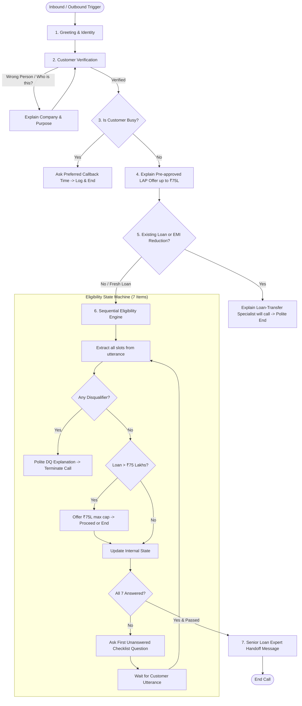

# AI Voice Agent — Home Credit Loan Against Property (LAP) Qualification

## 📌 Executive Summary
This project implements an enterprise-grade AI Voice Agent for **Home Credit**. The voice agent proactively calls existing customers about a pre-approved Loan Against Property (LAP) offer up to ₹75 Lakhs, verifies the customer, collects 7 eligibility data points sequentially with out-of-order extraction capability, handles interruptions/diversions, terminates immediately on disqualification, routes loan-transfer/EMI-reduction cases to specialists, and hands over qualified leads to a senior loan expert.

---

## 🏗️ 5-Layer Architectural Model

```
                          ┌────────────────────────┐
                          │     AI VOICE AGENT     │
                          └───────────┬────────────┘
                                      │
               ┌──────────────────────┴──────────────────────┐
               │                                             │
      ┌────────┴────────┐                           ┌────────┴────────┐
      │  CONVERSATION   │                           │    BUSINESS     │
      │     LAYER       │                           │     LOGIC       │
      ├─────────────────┤                           ├─────────────────┤
      │ • Greeting      │                           │ • 7 Data Points │
      │ • Verification  │                           │ • Hard Rules    │
      │ • LAP Pitch     │                           │ • ₹75L Cap Rule │
      │ • Busy Handler  │                           │ • Disqualify    │
      └────────┬────────┘                           └────────┬────────┘
               │                                             │
               └──────────────────────┬──────────────────────┘
                                      │
                        ┌─────────────┴─────────────┐
                        │       STATE / MEMORY      │
                        ├───────────────────────────┤
                        │ • Slot Extraction         │
                        │ • Out-of-Order Memory     │
                        │ • Diversion Stack         │
                        └─────────────┬─────────────┘
                                      │
                        ┌─────────────┴─────────────┐
                        │      DECISION ENGINE      │
                        ├───────────────────────────┤
                        │ • Loan Transfer? → Spec.  │
                        │ • Disqualified?  → End    │
                        │ • 7/7 Answered?  → Expert │
                        │ • Missing Slot?  → Ask    │
                        └───────────────────────────┘
```

---

## 🔄 End-to-End Conversational Workflow



---

## 📋 The 7 Eligibility Checkpoints & Slots

| # | Item Name | State Slot | Valid Values | Immediate Disqualification Trigger |
|---|---|---|---|---|
| **1** | **Property Type** | `property_type` | `Residential`, `Commercial`, `Industrial` | `Agricultural` |
| **2** | **Ownership Status** | `ownership_status` | `Sole ownership`, `Joint ownership` | None (Both are valid) |
| **3** | **Original Documents** | `documents_available` | `Available` (at home/bank) | `Unavailable` / `Photocopies only` |
| **4** | **Desired Loan Amount**| `loan_amount` | Up to `₹75,00,000` | If `> ₹75 Lakhs`, offer ₹75L limit. Disqualify only if customer refuses ₹75L. |
| **5** | **Occupation & Income Mode** | `occupation`, `income_mode` | `Salaried` / `Self-Employed` with **`Bank` Transfer/Cheque** | **`Cash` Income** (regardless of occupation) |
| **6** | **Estimated Market Value** | `market_value` | Any positive customer estimate | None (No minimum threshold in rules; do not fabricate one) |
| **7** | **Desired Tenure** | `tenure` | `3 to 15 Years` | `< 3 Years` OR `> 15 Years` |

---

## 🧠 Core Algorithmic Logic: "Extract First, Ask Missing"

Every time the customer speaks, the agent executes the following 6-step loop:
1. **Multi-Slot Extraction:** Extract every piece of eligibility data present in the utterance (e.g., if user mentions property type, ownership, and value together).
2. **Resolve Contradictions & Corrections:** Latest valid statement supersedes previous values (e.g., *"10 years, actually make it 12"* $\rightarrow$ `12 years`).
3. **Hard Disqualification Check:** Check if any extracted slot triggers an instant rejection (e.g., `Agricultural`, `Cash income`, `Photocopies only`, `Tenure < 3 or > 15`). If so $\rightarrow$ Explain politely & End Call immediately.
4. **Loan Transfer & EMI Branch Check:** Check if user mentioned an existing property loan or EMI reduction goal $\rightarrow$ Route to Transfer Specialist & End Call.
5. **State Update:** Save all valid extracted variables into internal memory.
6. **First-Missing-Question Selection:** Find the lowest numbered unanswered question from the 1–7 list and formulate a conversational, natural question.
